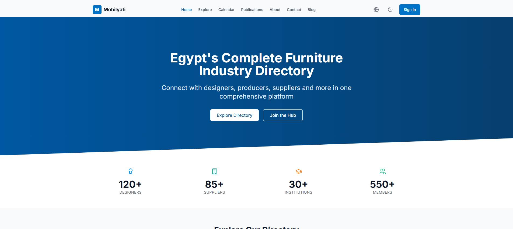
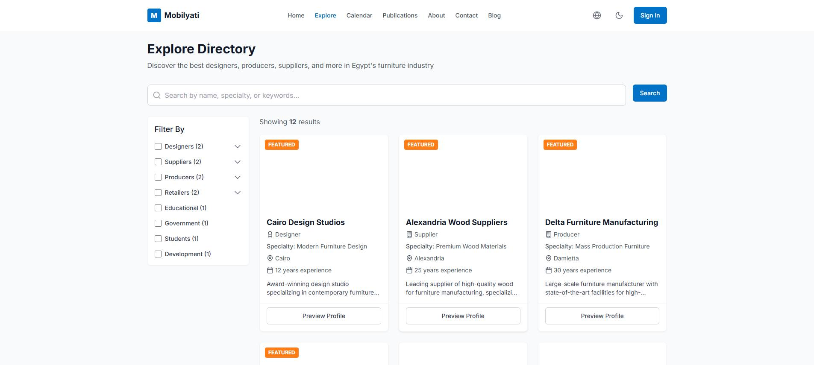
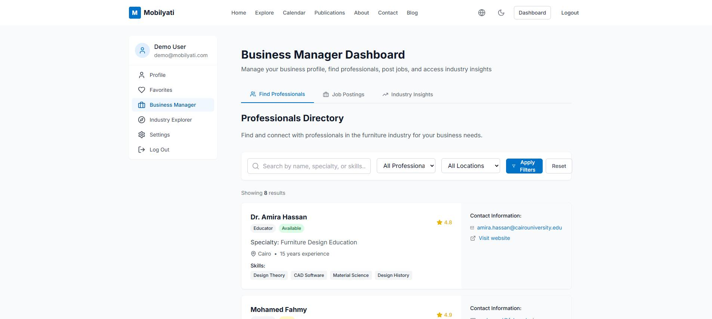
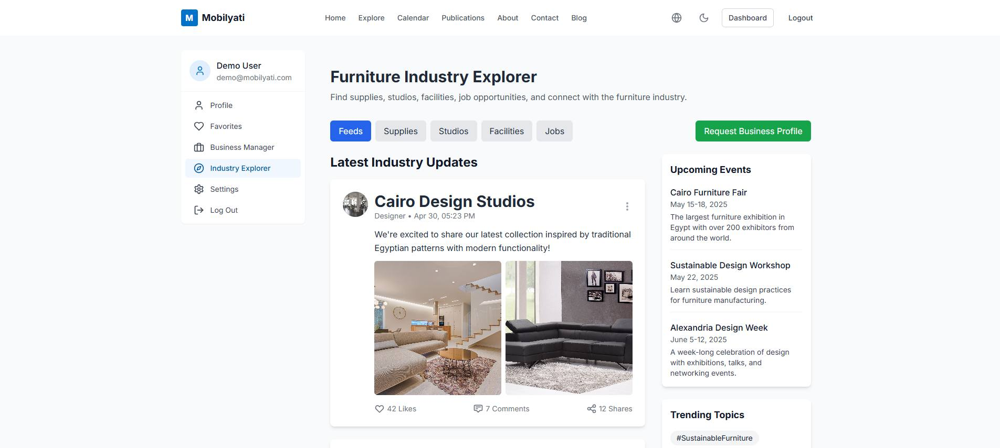
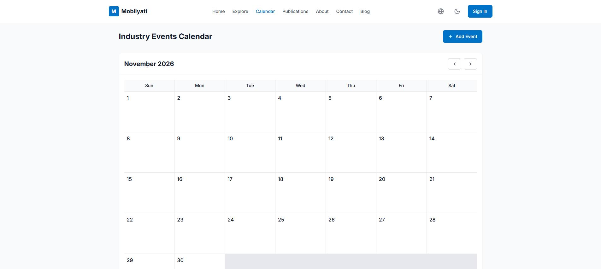
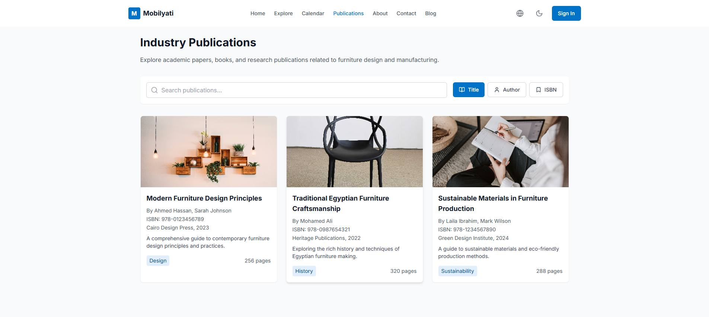

# Mobilyati — Egypt Furniture Industry Platform

A front-end marketplace and directory for Egypt's furniture industry. Mobilyati connects designers, producers, suppliers, retailers, educational institutions and students in one platform, and adds business tooling on top: a professionals directory, job postings, industry insights and a social industry feed.

**Live demo:** https://omar-gamal5.github.io/egypt-furniture-platform/

> **Demo project / front-end only.** There is no backend: users, profiles, jobs, events and publications are mock data, and authentication is simulated in `localStorage`. See [Notes & limitations](#notes--limitations).



## Screenshots

| Explore directory | Business manager dashboard |
| --- | --- |
|  |  |

| Industry explorer | Events calendar |
| --- | --- |
|  |  |

| Publications |
| --- |
|  |

## Features

### Public
- **Home** — hero, platform stats, category shortcuts and featured profiles.
- **Explore directory** — keyword search, category/location filters, sponsored results, bookmarking and profile pages.
- **Calendar** — monthly industry events calendar with add-event form.
- **Publications** — searchable list of books and research papers by title, author or ISBN.
- **About, Blog, Contact** — marketing and content pages.
- **Auth** — sign in / sign up (simulated), plus dark mode and English/Arabic toggle.

### Signed in
- **Profile dashboard** — editable business profile with completeness indicator.
- **Favorites** — saved profiles.
- **Business Manager** — professionals directory (search, profession/location filters), job postings and industry insights charts.
- **Industry Explorer** — industry feed, supplies, studios, production facilities and job opportunities, plus a request-business-profile flow.
- **Settings** — language/region, notification preferences, profile visibility and password form.

## Tech stack

| Area | Choice |
| --- | --- |
| Framework | React 18 + TypeScript |
| Build tool | Vite 5 |
| Routing | React Router 6 |
| Styling | Tailwind CSS 3 + `tailwind-merge` / `clsx` |
| Icons | lucide-react |
| Charts | Recharts |
| Maps | Leaflet + react-leaflet |
| Forms | Formik + Yup |
| Dates | date-fns |

## Getting started

**Requirements:** Node.js 18+ and npm.

```bash
# install dependencies
npm install

# start the dev server (http://localhost:5173)
npm run dev

# production build into dist/
npm run build

# preview the production build
npm run preview

# lint
npm run lint
```

### Demo login

Authentication is mocked, so **any email and password work** — no account is required to browse. Sign in to unlock the dashboard pages:

```
Email:    demo@mobilyati.com
Password: demo1234
```

The signed-in user is stored under the `furniture_hub_user` key in `localStorage`; remove it (or use Log Out) to reset.

## Deployment

Deployed with **GitHub Pages** using `.github/workflows/deploy.yml`. Every push to `main` runs `npm ci` → `npm run build`, then publishes `dist/` via `actions/deploy-pages@v4`. Pages is configured with **GitHub Actions** as the deployment source in the repository settings.

Two details make the SPA work on Pages:
- `vite.config.ts` builds with `base: /egypt-furniture-platform/`, and `BrowserRouter` uses `basename={import.meta.env.BASE_URL}` so routes resolve under the repository sub-path.
- `404.html` is a second Vite entry. GitHub Pages serves it for unknown paths, so direct links such as `/explore` still boot the app and client-side routing takes over. `public/.nojekyll` keeps Pages from ignoring generated files.

To deploy your own copy, fork the repo, rename `REPO_NAME` in `vite.config.ts` to your repository name, push to `main`, and select **GitHub Actions** as the Pages source.

## Project structure

```
src/
├── components/
│   ├── actions/      bulk actions table
│   ├── ads/          ad banner
│   ├── auth/         route guards and feature guards
│   ├── business/     professionals directory, job postings, insights
│   ├── copilot/      AI copilot interface (UI only)
│   ├── explore/      search, filters, profile cards
│   ├── feed/         dynamic industry feed
│   ├── individual/   feed list, interactive map, job application, business profile request
│   ├── layout/       header, footer, layout shell
│   ├── messaging/    WhatsApp share button
│   └── ui/           Button, Card
├── contexts/         auth, UI, copilot, business manager, individual user
├── pages/
│   ├── dashboard/    profile, favorites, settings, business manager, industry explorer
│   └── ...           home, explore, profile, calendar, publications, about, blog, contact, auth
├── types/            shared TypeScript models
└── utils/            mock data and helpers
```

## Notes & limitations

- **No backend.** Everything is client-side mock data (`src/utils/mock*.ts`); changes such as a new event or profile edit are not persisted beyond the current session.
- **Mock auth.** Credentials are accepted without validation and role/feature flags are hard-coded for the demo (the signed-in user is treated as a business-profile manager).
- **Calendar** opens on the current month, while the seeded events are dated in 2025, so it can look empty at first — use the month arrows.
- **`whatsapp-web.js` is a Node-only library.** `src/utils/whatsapp.ts` imports it, but nothing in the app imports that module today. Don't import `WhatsAppButton` into the browser bundle without moving that logic to a server — it will break the build.
- **Test files** under `components/individual/__tests__` are Jest-style; no test runner is configured in this project.

## License

Academic / portfolio project. Add a license if you plan to reuse or distribute the code.
